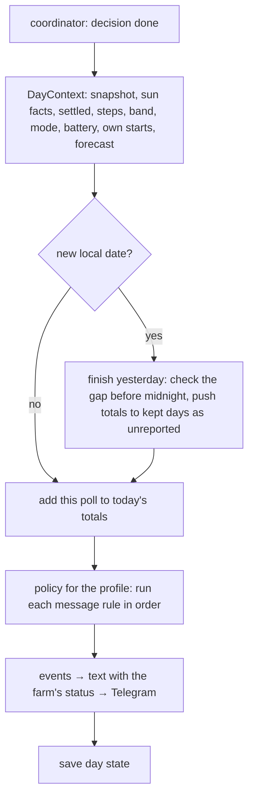

# feat: day messages follow the solar day as a message policy, and a day report at midnight

## Summary

Replace the hard-coded four conditions in `day_report.py` with a **message policy**: ordered message rules in their own package, chosen by the farm's profile, each with one test and one knowledge-base entry. Solar-follow's policy follows the solar day (first usable production, miners at full load, a step down that matches the sun's decline, the sun below the horizon) and reports the farm's status in every message. A **day report** closes each calendar day at midnight: one computed Telegram text, also shown in HA and sendable on request, with a forecast-against-actual ratio kept as a sensor.

---

## Problem Frame

0.8.4's day report opens the day at the first miner seen mining and closes it when nothing mines after sunset. On 2026-10-14 a manual start at 01:28 sent "Production is up" and "Day done" at night and swallowed the real morning; on 2026-10-15 HA came back at 10:08 with the miners already running and said nothing. Its energy totals also count a missing PV reading as 0 W, which undercounted the reference farm's solar by about 30% (29.6 against 42.1 kWh on 2026-10-12), and count the grid import only while a miner mines. The four messages are `if` blocks in one module, so a farm with a battery or other loads has nowhere to get its own day story (see origin: `docs/brainstorms/2026-10-15-sun-driven-day-messages-requirements.md`).

---

## Requirements

Carried from the origin with the same IDs. R16 was dropped in the origin and stays dropped.

**The message policy**
- R1. The day messages come from a message policy: an ordered list of message rules, each with a name, a trigger and the text it sends.
- R2. Each farm profile names its message policy; Solar-follow names the sun-driven policy.
- R3. Each message rule has one place in the code, one test and one knowledge-base entry.
- R4. Message rules only observe; they never change a decision.
- R5. Each message rule fires at most once per day, and the day's sent messages survive an HA restart.
- R6. The existing Day messages switch turns the whole policy on or off, the day report included.

**The sun-driven policy (Solar-follow)**
- R7. Morning: once, at the day's first usable production, with the forecast for the rest of the day and the farm's status.
- R8. Morning is never sent while the sun is below the horizon.
- R9. When HA starts after the day's first usable production, morning is sent at once and says the integration picked up the day.
- R10. Peak: once, when every miner is at its top step, settled and below the band, on two polls in a row.
- R11. Going down: once, at the first step down or stop after solar noon while the next-hour forecast is below the forecast now.
- R12. Any other step down or stop sends nothing and is counted as a cloud step-down.
- R13. Evening: once, when the sun goes below the horizon; it says when the last miner stopped and how many cloud step-downs the day had, and points to the midnight report.
- R14. Evening is sent on a day without usable production too, and says so.

**The farm's status**
- R15. Each message states each miner's state: mining at which limit, stopped, or unavailable.
- R17. Each message names the control mode when it isn't Automatic.
- R18. The evening message says when miners are still mining after sunset.
- R19. With a battery configured, the evening message doesn't say the day is done.

**The day report**
- R20. It covers one local calendar day: solar, the miners' energy and its solar share, house and other loads, grid import and export, and the share of the solar used on site.
- R21. One Telegram text, sent automatically just after local midnight for the day that ended.
- R22. It can be sent on request for today so far or a kept earlier day, from a button and from an action with a day and a test flag; a test report says so in its first line.
- R23. Per miner: energy, mining hours, average hashrate and J/TH; plus first and last production, the best 15 minutes of solar, and commands by kind.
- R24. Three or more starts of one miner within an hour are named as a flip-flop warning.
- R25. The house load is shown as a remainder and says so.
- R26. Forecast against actual: the morning's forecast for the day, the solar that came, and their ratio, kept per day as a sensor; left out without forecast sensors.
- R27. The latest report's text is shown in HA.
- R28. A reading that isn't configured leaves its line out; a short gap holds the last value; a longer gap, or the integration not running for part of the day, marks the day incomplete.
- R29. The report only observes.

---

## Key Technical Decisions

- **A `messages/` package mirrors `decision/`.** One module per message rule, a context object carrying one poll's facts through them, and an ordered tuple per policy in `messages/__init__.py`. The package docstring lists the order, like `decision/__init__.py`. Rationale: the owner asked for the same discipline as the miner rules, and the same shape makes the "one rule, one test, one entry" check mechanical.
- **Policy is chosen by profile, in code.** A `MESSAGE_POLICIES` mapping keyed by profile name sits beside `PROFILES` in `const.py`; Solar-follow → the sun-driven policy. A profile with no policy sends no day messages. No runtime setting.
- **The day report is the policy's last rule, not a separate system, and it retries until sent.** On a new date, yesterday's totals go into `kept_days` with `reported: false`. The rule fires on any poll where the newest kept day is unreported, and the flag flips only after the event is saved. A failed poll, an exception in an earlier rule or a Pi that was off at midnight therefore still gets the report out later. One definition of the day's totals serves the report.
- **"First usable production" is the integration's own first successful start, or the PV reading at or above the lowest configured power step on two polls in a row, whichever comes first, and only while the sun is up.** "Usable" then means what it says: enough for the smallest step. `transition.sunrise` is not used here. On a zero-export site it can only sample while the site imports, so it fires at first light, and a house load switching off reads as a rise. First and last production in the report use the same threshold, so there is one definition. An own start is any start the controller sent that finished `ok`, Manual-mode Apply included; the morning uses the time the command was sent. A start made outside the integration never counts.
- **Pickup is the first poll since HA (re)started, on any date.** When that poll finds morning unsent, the sun up, and a miner mining or the PV at or above the lowest step, morning fires at once with the "picked up" wording. It doesn't matter whether the date changed or not.
- **Solar noon has passed when the sun is up and `sun.sun`'s `rising` is false.** The coordinator already reads `rising` for the transition, so no second definition is added.
- **Without `sun.sun`**, morning relies on the own-start and PV conditions alone, and evening on the existing sunset latch.
- **"Going down" without a next-hour forecast falls back to "after solar noon".** It doesn't disappear on farms without forecast sensors (origin assumption, now decided).
- **Energy is integrated from the configured power readings, holding a missing reading for up to `READING_HOLD_S` (180 s).** The inverters' gaps last about a minute, which is longer than `GAP_POLLS` × 15 s. `GAP_POLLS` keeps its own job: a gap between polls (HA down). A reading missing longer than the hold, or a poll gap beyond `GAP_POLLS`, is not filled and marks the day incomplete; the figure stays in the report with the incomplete note. A day is also incomplete when its last poll is more than `GAP_POLLS` polls before midnight or its first poll more than that after midnight, so a gap that spans midnight is caught on both sides. The grid import counts all day. This fixes the 0.8.4 undercount without a new setting. Measured on 2026-10-12: 42.15 kWh against the inverters' counters at 42.10.
- **Per-miner figures come from the snapshot.** Energy is the miner's `power_w` integrated; mining hours and average hashrate come from `hashrate_th` while mining (`control.is_mining`); J/TH is energy over hashes.
- **One command record per day.** `_async_record_action` appends every command event that finished `ok` (time sent, miner, kind: start, stop, limit) to the day state. Own starts, commands by kind and the flip-flop finder all read it.
- **A cloud step-down is counted once per poll** in which the farm's total limit goes down or a miner stops, restarts excluded. Three miners stepping down in one poll count as one.
- **Earlier days are the integration's own kept reports, not the recorder.** The day `Store` keeps the last 7 finished days' totals. On request, any of those is re-rendered, and "today so far" comes from the running totals. Rationale: long-term statistics would need counter sensors the integration isn't configured with, and a week covers "resend yesterday's report".
- **The text template lives in the integration; the prototype imports it.** `scripts/farm_day.py` keeps its counter-based computation as a cross-check on the integration's power integration, not as a second source of truth, and formats with the integration's template. AE7 checks both against the same figures.
- **The morning's forecast is the last `forecast_remaining_kwh` read before first production.** Before any production, "remaining today" is the whole day. A day picked up after first production has no morning forecast, and the line is left out.
- **The forecast ratio is a sensor with its history in the recorder.** State: actual ÷ forecast for the last finished day. Attributes: date, forecast kWh, actual kWh.
- **One spelling for rule names: hyphenated.** The rules are `morning`, `peak`, `going-down`, `evening`, `day-report`; their entries are `message.<name>`.
- **The `send_day_report` action is registered once, in a new `async_setup`,** with `CONFIG_SCHEMA = cv.config_entry_only_config_schema(DOMAIN)` for hassfest. An optional `config_entry_id` field picks the farm; it defaults to the only loaded entry and raises a service error when there are several and none is given.
- **Message rules' knowledge-base entries live in a new `knowledge/messages.yaml`** with `message.` ids, P3, status decided. `tests/test_knowledge.py` checks that every rule in every policy has an entry and every entry names a rule that exists.
- **Stored 0.8.4–0.8.6 day state loads into the new shape.** `all_max` → `peak`, `step_down` → `going_down`. A restart on upgrade day repeats nothing.
- **Decision rule count is unchanged.** Nothing in `decision/` changes. Message rules go from 4 conditions to 5 rules (morning, peak, going down, evening, day report), each now with a test and an entry.

---

## High-Level Technical Design

One poll, after the decision. This is the order of the work, not code:

The message rules of the sun-driven policy, in order:

| Order | Rule | Fires when (once a day) | Notes |
|---|---|---|---|
| 1 | `morning` | sun up and (own successful start, or PV ≥ lowest step on 2 polls) | first poll since HA started with a miner mining or PV ≥ lowest step → at once, "picked up" wording |
| 2 | `peak` | all miners at top step, settled, below band, 2 polls | as 0.8.4's all_max |
| 3 | `going-down` | step down/stop with the sun up and not rising, and next-hour forecast < now | other step-downs → cloud count, once per poll |
| 4 | `evening` | sun below the horizon | "no usable production" when first usable production never came; no "day done" with a battery |
| 5 | `day-report` | newest kept day not yet reported | for the day that ended; incomplete when gaps |

---

## Implementation Units

### U1. The `messages/` package and the policy registry

**Goal:** an ordered message policy, chosen by profile, that runs message rules and keeps the day's state; the old `day_report.py` logic moves into it unchanged first.

**Requirements:** R1, R2, R4, R5, R6

**Dependencies:** none

**Files:**
- `custom_components/solar_smart_miner/messages/__init__.py` (policies, `run_policy`)
- `custom_components/solar_smart_miner/messages/context.py` (DayContext, DayState load/save, old-name mapping)
- `custom_components/solar_smart_miner/messages/status.py` (the farm-status lines)
- `custom_components/solar_smart_miner/const.py` (`MESSAGE_POLICIES`)
- `custom_components/solar_smart_miner/coordinator.py` (`_async_report_day` calls the policy run)
- `custom_components/solar_smart_miner/day_report.py` (removed in this unit)
- `tests/test_messages_policy.py`

**Approach:** Start by moving the existing behaviour behind the new structure, coordinator call included, so the old module goes in the same unit and every commit passes the post-commit hook. Behaviour changes in U3. DayState keeps the existing dict shape (date, sent, energy fields) plus `kept_days`. The Store key stays `solar_smart_miner.day_report.<entry>`, so the saved day survives. `run_policy` returns the events in order; the coordinator sends them.

**Patterns to follow:** `decision/__init__.py` (group order in the docstring, `_run` loop), `decision/context.py` (one context object).

**Test scenarios:**
- A profile with a policy runs its rules in the listed order; a profile without one returns no events.
- Each rule fires at most once a day; a state loaded from the Store with a rule in `sent` doesn't fire it again.
- A stored 0.8.6 state with `sent: ["morning", "all_max"]` loads as morning and peak sent.
- A broken stored file starts a fresh day (as today).
- The Day messages switch off: events are computed and saved, nothing is pushed.

**Verification:** the existing `tests/test_day_report.py` behaviours that survive pass against the new package; the module count and docstring list match.

### U2. Sun and command facts in the coordinator

**Goal:** give the policy the facts it needs without new definitions: sun up, solar noon passed, the first poll since HA started, the day's command record, the lowest power step, the control mode, the battery setting.

**Requirements:** R7, R8, R9, R11, R13, R17, R19

**Dependencies:** U1

**Files:**
- `custom_components/solar_smart_miner/coordinator.py` (`_async_report_day` builds DayContext; command events record own starts)
- `tests/test_coordinator.py`

**Approach:** Noon passed = sun above the horizon and `rising` false. The command record: `_async_record_action` appends every `ok` event (time sent, miner, kind) to DayState. A flag set at coordinator start marks the first poll of this process. When `sun.sun` is missing, sun up is unknown: morning uses its own-start and PV conditions alone, and evening uses the existing sunset latch.

**Patterns to follow:** `_update_transition` (how `sun.sun` attributes are read), `_async_record_action`.

**Test scenarios:**
- Sun up and `rising` false gives noon passed; `rising` true or the sun down gives not passed.
- A start, a stop and a limit change finishing `ok` are each recorded with their kind; a refused or failed command is not.
- A Manual-mode Apply start that finishes `ok` counts as an own start, timed when it was sent.
- Without `sun.sun`, an own start opens the morning and the sunset latch drives the evening.

**Verification:** a coordinator cycle in tests produces a DayContext with each fact populated from fixtures.

### U3. The sun-driven policy's four milestone rules

**Goal:** morning, peak, going down and evening as in the table above, each in its own module, every message carrying the farm's status.

**Requirements:** R7–R15, R17–R19

**Dependencies:** U1, U2

**Files:**
- `custom_components/solar_smart_miner/messages/morning.py`
- `custom_components/solar_smart_miner/messages/peak.py`
- `custom_components/solar_smart_miner/messages/going_down.py` (rule `going-down`)
- `custom_components/solar_smart_miner/messages/evening.py`
- `tests/test_messages_rules.py` (one test group per rule)
- `tests/test_day_report.py` (migrated into the file above, behaviour changes rewritten, not deleted)

**Approach:** Morning, peak, going down and evening follow the table and the Key Technical Decisions. Peak keeps 0.8.4's all_max logic and adds the time since the morning. Going down reuses 0.8.4's step-down detection (restart excluded, two polls for a stop). Evening's "no usable production today" depends on first usable production never having come, not on whether the morning message was sent. Status lines: each miner's state and limit, plus the mode when it isn't Automatic.

**Patterns to follow:** `day_report._stepped_down`, `_note_reasons`, `describe()` wording style ("A reading that is missing leaves its part out").

**Test scenarios:**
- Covers AE1. 01:28, sun below, a miner mines 40 s: no event; later, with the PV at the lowest step for two polls, morning fires once.
- A 200 W house load switching off just after sunrise doesn't open the morning.
- Covers AE2. First poll at 10:08 with sun up and three miners at 2,000 W: morning fires at once with "picked up" and three status lines; peak fires once all three are at top and settled for two polls, and gives the time since the morning.
- A same-date state saved at 03:00 and loaded at 10:08 with miners mining: morning fires at once with "picked up".
- Three miners stepping down in one poll before noon count as one cloud step-down.
- Covers AE3. Step down at 12:10 (noon not passed): no event, cloud count 1; step down at 16:40 with next-hour forecast below now: going down fires; evening says one cloud step-down.
- Going down without forecast sensors fires on the first step down after noon.
- Covers AE4. No production all day: at sunset evening fires with "no usable production".
- Covers AE5. Mode Manual: each message names Manual mode.
- Covers AE6. Battery present, two miners mining at sunset: evening lists them and has no "Day done".
- An own start opens the morning before the PV reaches the lowest step; a start made outside the integration in daylight doesn't open it.
- An own start (Manual-mode Apply) at 09:00 on an overcast day whose PV never reaches the lowest step: morning is sent on the own start, and the evening doesn't say "no usable production", because an own start is first usable production by definition.
- A restart after a limit change is not a stop (kept from 0.8.4).
- Peak never comes: no peak event; evening carries "Peak: N of M at the top step".

**Verification:** every rule module has its tests; the farm-sim day gives morning → peak → going down → evening once each.

### U4. Knowledge-base entries for the message rules

**Goal:** one entry per message rule, checked by tests.

**Requirements:** R3

**Dependencies:** U3, U6 (all five rules exist)

**Files:**
- `custom_components/solar_smart_miner/knowledge/messages.yaml`
- `custom_components/solar_smart_miner/knowledge/README.md` (lists the file)
- `tests/test_knowledge.py`

**Approach:** Entries `message.morning`, `message.peak`, `message.going-down`, `message.evening`, `message.day-report`, plus `message.policy` stating that message rules only observe and are chosen by profile. Each is P3 and decided, with the principle in `statement` and the reference farm's two days in `source`. No miner or entity names. Retire the `report.day-messages` situation entry if the 0.8.4 work added one, pointing to the new entries.

**Patterns to follow:** `knowledge/rules.yaml` entry shape; the name checks in `tests/test_knowledge.py`.

**Test scenarios:**
- Every rule in every policy in `MESSAGE_POLICIES` has a `message.` entry, and every `message.` entry except `message.policy` names a rule that exists.
- The new file passes the existing field, uniqueness and no-names checks.

**Verification:** `tests/test_knowledge.py` fails when a rule is added without an entry.

### U5. The day's totals

**Goal:** one definition of the day's figures, integrated per poll and kept for 7 days.

**Requirements:** R20, R23, R24, R25, R26, R28, R29

**Dependencies:** U1, U2

**Files:**
- `custom_components/solar_smart_miner/messages/totals.py`
- `tests/test_messages_totals.py`
- `tests/fixtures/day_2026-10-12.json` (the reference day's readings, reduced to what the totals need)

**Approach:** Per poll, add solar (`pv_power_w`, else `solar_production_w`), import and export (sign of `grid_net_w`), the miners' sum, each miner's `power_w`, and hashrate × seconds while mining. Also track first and last production (PV at or above the lowest power step, the same threshold as the morning) and the best 15-minute solar slice. Gaps and `incomplete` follow the Key Technical Decisions (`READING_HOLD_S`, `GAP_POLLS`, both sides of midnight). House = solar + import − export − miners. Commands by kind come from U2's command record. The flip-flop finder uses the prototype's `start_burst` (3 starts within 60 min). The morning forecast is the last `forecast_remaining_kwh` before first production. On a new date the finished totals are pushed to `kept_days` (at most 7).

**Patterns to follow:** `scripts/farm_day.py` `compute_day` (the dict shape the template reads, `start_burst`), `day_report._add_energy`.

**Execution note:** start with a failing test that replays the 2026-10-12 fixture with one-minute PV gaps and expects about 42.1 kWh of solar, not the 29.6 that 0.8.4 counts.

**Test scenarios:**
- Covers AE7. The 2026-10-12 fixture gives solar 42.1 ± 0.2 kWh, miners 45.8 ± 0.3, import 13.0 ± 0.3, export 0.0, best 15 min about 8.2 kW at 11:00, first and last production 07:26–18:10, and Brod1's four starts 07:47–08:29 as a flip-flop. Small differences from the counter-based prototype are within the stated tolerance.
- At the 15 s default poll interval, a 60 s PV gap holds the last value and leaves the day complete; a PV gap longer than 180 s is not filled and marks the day incomplete.
- Last poll at 22:00 and the next at 08:00: yesterday is incomplete and today is incomplete.
- Import is counted when no miner mines (night house load).
- A miner paused all day has 0 kWh, 0 h and no J/TH.
- Two starts within an hour are not a flip-flop; three are.
- No forecast sensors: no forecast figures; picked up after first production: no morning forecast.
- An eighth finished day drops the oldest kept day.

**Verification:** the fixture test passes with the integration's own integration of power readings.

### U6. The day report: text, schedule, button, action, sensors

**Goal:** send the report after midnight, on request and as a test, and show it and the forecast ratio in HA.

**Requirements:** R21, R22, R26, R27, R6

**Dependencies:** U5

**Files:**
- `custom_components/solar_smart_miner/messages/day_report.py` (the rule and the template)
- `custom_components/solar_smart_miner/services.yaml` (`send_day_report`: `date`, `test`, `config_entry_id`)
- `custom_components/solar_smart_miner/__init__.py` (`async_setup`, `CONFIG_SCHEMA`, the action)
- `custom_components/solar_smart_miner/button.py` (Send day report: today so far, as a test)
- `custom_components/solar_smart_miner/sensor.py` (Day report sensor: state the date, text in an attribute; Forecast accuracy sensor)
- `custom_components/solar_smart_miner/strings.json`, `custom_components/solar_smart_miner/translations/en.json`
- `scripts/farm_day.py` (format with the integration's template)
- `tests/test_messages_day_report.py`, `tests/test_apply_entities.py`, `tests/test_farm_day.py`

**Approach:** The template is a port of `format_text`, with the forecast line, the house-as-remainder note, the incomplete line and the test first line added. The rule fires at the first poll of a new date. The action takes an optional date: today, or one of the kept days (an unknown date raises a clear service error). The button sends today so far as a test. The report sensor's state is the report's date; the full text is an attribute, since a state holds at most 255 characters. The forecast sensor updates when a day is finished.

**Patterns to follow:** existing button and sensor descriptors in `button.py` and `sensor.py`; `Notifier.notify(..., push=True, persistent=False, cooldown_min=0)` as the day messages use it.

**Test scenarios:**
- Covers AE7. The 2026-10-12 totals render the origin's lines (solar, miners with solar share, house as remainder, grid, self-use, commands, the flip-flop warning).
- A test report's first line marks it as a test.
- The action with a kept date sends that day; with an unknown date it raises a service error and sends nothing.
- The button sends today so far, marked as a test.
- The first poll of a new date sends yesterday's report once; a restart right after doesn't send it again.
- An exception in the morning rule on the first poll after midnight: the report is sent on the next poll.
- Two config entries and no `config_entry_id`: service error; with one entry, it defaults to that one.
- HA down at midnight and back at 08:00: yesterday's report is sent then and says the figures are incomplete.
- The Day messages switch off: no report is pushed, but the sensors still update.
- The forecast sensor shows actual ÷ forecast for the finished day; without forecast sensors it stays unknown.
- The prototype's text for the 2026-10-12 fixture equals the integration template's output for the same dict.

**Verification:** hassfest accepts `services.yaml` and the strings; the report text for the fixture matches AE7.

### U7. Wiring, replays, docs, release

**Goal:** the coordinator runs the policy, the two farm days are replay tests, the docs describe the package, and 0.8.7 ships.

**Requirements:** all; covers AE1, AE2 end to end

**Dependencies:** U1–U6

**Files:**
- `custom_components/solar_smart_miner/coordinator.py`
- `tests/test_farm_sim.py` (a sunny day: exactly morning → peak → going down → evening → report)
- `tests/test_coordinator.py` (the 2026-10-14 night start and the 2026-10-15 pickup through a real cycle)
- `CLAUDE.md` (project structure: `messages/`)
- `docs/plans/2026-10-09-002-feat-telegram-notifications-plan.md` (note that U4/U5 are superseded by this plan)
- `custom_components/solar_smart_miner/manifest.json` (0.8.7, in the last commit)

**Approach:** The policy is wired in U1; this unit adds the end-to-end replays. The farm-sim test is the integration check that message rules don't meet each other badly: no rule fires twice, and none fires out of order.

**Test scenarios:**
- Covers AE1. Coordinator at 01:28 with sun below and a miner mining: no push.
- Covers AE2. Coordinator first cycle at 10:08 with miners at 2,000 W: morning push with "picked up".
- A farm-sim sunny day pushes the five messages once each, in order.

**Verification:** full test suite green; validate workflow green; release 0.8.7 published.

---

## Scope Boundaries

**Deferred for later** (from origin)
- The battery profiles' own message policies; farms with more miners or other loads.
- Alerts for unexpected events (a miner mining at night, a cloud stopping everything): the Telegram plan's U6.
- The infographic card, the day's grid cost, a bitcoin estimate, AI commentary.

**Dropped** (from origin)
- Comparison with yesterday or a 7-day average; who started each miner.

**Outside this work**
- Any change to `decision/`. Reordering or editing message rules at runtime.

### Deferred to Follow-Up Work
- The decision's safety estimate needs `pv_power_w` and skips during the inverters' one-minute gaps (`decision/safety.py`). Whether it should hold the last reading like the totals is a decision change, so it gets its own replay and release.
- Choosing the forecast service is `docs/plans/2026-10-15-001-feat-solar-forecast-comparison-plan.md`. This plan only measures whichever forecast is configured.

---

## Risks & Dependencies

- **Upgrade-day state.** A 0.8.6 day state loaded mid-day must neither resend morning nor lose today's energy; U1's mapping test covers it.
- **hassfest and the new action.** `services.yaml` and strings must validate before release; run the validate workflow on the push before bumping the manifest.
- **Light threshold for first and last production.** It is a constant; on the reference farm the prototype's threshold matched the inverter logs. A farm with a much smaller array may need it lower. Keep it a constant until another farm shows otherwise.
- **The prototype imports the integration.** `scripts/farm_day.py` then needs the dev environment with Home Assistant installed. That environment is already where it runs.

---

## Sources & Research

- `custom_components/solar_smart_miner/day_report.py`: the logic being moved (`_stepped_down`, `_add_energy` with `or 0.0`, the pickup rule at the new-day branch).
- `custom_components/solar_smart_miner/decision/__init__.py`: the ordered-groups pattern the package mirrors.
- `custom_components/solar_smart_miner/transition.py`: the sunrise definition reused for first production.
- `custom_components/solar_smart_miner/coordinator.py`: `_async_report_day`, `_update_transition` (sun attributes), `_async_record_action` (command events).
- `scripts/farm_day.py`, `tests/test_farm_day.py`: the prototype's totals, template and flip-flop finder.
- Farm history: 2026-10-14 01:28 manual start, 2026-10-15 10:08 pickup, 2026-10-12 reference day (git-ignored `config/farm-history/`).
