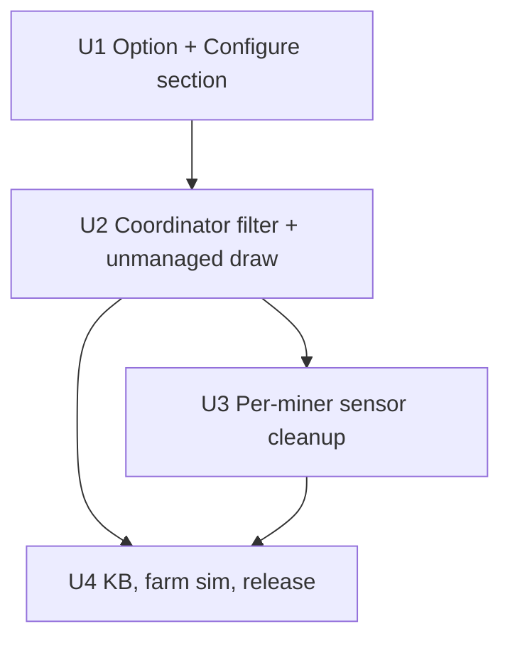

# feat: Choose which miners the integration manages

## Summary

Add a **Managed miners** section to Configure: a multi-select of every miner hass-miner knows, all ticked by default. The integration leaves a miner the owner unticks alone. It doesn't treat it as a miner, doesn't plan for it, never sends it a command, shows it to neither the AI nor the day messages, and drops its per-miner sensors. Only its power entity is still read, as one sum (`unmanaged_miners_w`). Its draw still reaches the house meter, so it counts as part of the house load, which it really is. Wherever the code adds up the miners' draw to take it out of a reading (the meter-lost estimate, and the production the sunrise/sunset helper watches), the unmanaged sum is added as well.

The filter sits in one place, where the coordinator reads the miners. Every module downstream already works on `snapshot.miners`, so it only ever sees the managed ones. **No decision rule is added, changed or removed** (the count stays the same).

---

## Problem Frame

The integration manages every enabled hass-miner config entry as one farm (`coordinator._async_read_miners`). When one miner is faulty and can't be controlled, it stays in the decision anyway. The decision keeps planning for it, Automatic keeps sending it commands that fail, and the farm's pacing (the ramp lock, one change at a time, pending commands) waits on a miner that will never settle. Today the only way to take it out is to disable its hass-miner entry, which also loses its readings in HA. The owner needs to take a miner out of the integration's hands without touching hass-miner.

---

## Requirements

- R1. Configure has a section listing every miner hass-miner knows, by name, where the owner picks which ones the integration manages.
- R2. All miners are managed by default. A miner added to hass-miner later is managed at once, as it is today (owner, 2026-10-23). Existing installs behave exactly as before until a miner is unticked.
- R3. An unmanaged miner gets no plan and no command, in Manual (Apply, Apply all) and in Automatic alike, and its own changes (restarts, dropping out) never start a ramp lock or a pending check for the managed ones. The one exception, accepted: the first ramp lock after the save that unticks it may still come from its last command (see System-Wide Impact).
- R4. An unmanaged miner is absent as a miner from the decision trace, the AI prompt and AI log, the decision log's per-miner entries (and so the replays), the day messages, and the per-miner and miner totals of the day report and the hub. Its draw appears only as the `unmanaged_miners_w` sum, and in the day report as part of the house figure.
- R5. An unmanaged miner's per-miner sensors are removed from the entity registry rather than left unavailable. Ticking it again brings them back.
- R6. Its draw is still accounted for: the grid balance already holds it (the house meter includes it), and both the meter-lost import estimate and the sunrise/sunset production add it, so its swings are not read as the sun.
- R7. Changing the selection applies on save (the usual reload), with no HA restart.
- R8. Per CLAUDE.md: tests in the same commit, the knowledge-base entry updated, the number of decision rules unchanged, and a patch release (0.8.12).

---

## Scope Boundaries

- No per-miner "managed" switch entity on the dashboard. Configure is the only place to change it (a switch could come later).
- The integration doesn't stop or otherwise touch a miner when it is unticked. It stays as it was left.
- No automatic unmanaging of a miner that keeps failing. The owner decides.
- The AI isn't told by name which miners are unmanaged; it sees only the managed miners and the house load.

### Deferred to Follow-Up Work

- A line in the AI's "This farm" block naming the unmanaged miners, if the AI's advice turns out confused by a higher house load.
- The day report counts an unmanaged miner's energy as "house". Splitting it out is not needed now.
- Unticking a miner in the middle of a day can keep that day's **peak** message from firing, and with it the evening's peak line. `messages/peak.py` and `messages/evening.py` use the most miners seen that day (`state["miners"]`), and the unticked one no longer shows. It affects one day only; accept it rather than add a rule.
- A miner that comes back under a new IP (a DHCP reset, or re-added in hass-miner) is managed again without notice: the ids are IPs, and new miners are managed by default. A warning for it would be a separate feature.
- Unticking is all or nothing. A miner whose pause switch or relay still works also leaves the safety rules (the low-voltage stop never picks it). The knowledge-base entry says so, so the owner knows the trade.

---

## Context & Research

### Relevant Code and Patterns

- `custom_components/solar_smart_miner/coordinator.py`, `_async_read_miners`: the single loop over `hass.config_entries.async_entries(HASS_MINER_PLATFORM)`. Disabled entries are already skipped here, the same kind of filter. The miner id is `entry.data["ip"]`, or the entry id when there is no IP.
- `coordinator.miner_display_name(hass)`: (id, name) for every enabled hass-miner entry. The options flow already uses it for the relay step (`_miner_choices`), and it must keep listing **all** miners so the owner can tick an unmanaged one again.
- `config_flow.py`, `SolarSmartMinerOptionsFlow.async_step_edit_miners`: the existing per-miner option (`CONF_MINER_RELAYS`, keyed by miner id). The new option follows the same key convention. Menu in `async_step_init`.
- `__init__.py`, `_remove_retired_entities`: the pattern for dropping registry entries at setup, before platforms load.
- `sensor.py`: per-miner sensors are added dynamically from `coordinator.data.miners` (`_add_new_miners`), with unique id `{entry.unique_id or entry.entry_id}_{miner_id with . → _}_{metric key}` from `_MINER_METRICS`.
- `decision/safety.py`, `estimated_import_w`: miners' draw + base load − PV, the one definition used by the decision and by the step-down timer.
- `decision/__init__.py`, `build_decision`: "No hass-miner miners found" when `snapshot.miners` is empty.
- `decision_log.py`, `_known`: older log lines load on newer dataclasses, so a new `EnergySnapshot` field with a default keeps the replays working.
- Translations: `strings.json` and `translations/en.json` (both), options `step` and `init.menu_options`.

### What downstream needs no change (verified)

Everything below reads `snapshot.miners` or the controller's records and so gets the filter for free. Decision groups (`decision/*`), `control.py` (it is only called with miners from the snapshot), `_async_apply_auto`, `async_apply_all` and `async_apply_shown`, `_minutes_since_change` (ramp lock), `ai.py` and `ai_log.py`, `decision_log.py`, `messages/*` and `totals.py`, `button.py`, and the hub sensors. The options-flow reload rebuilds the controller, so a command still pending for a newly unmanaged miner is dropped and not checked against it later. The "fleet changed" alert in `knowledge/alerts.yaml` is catalogue only and is not implemented in code, so nothing there reacts to a miner disappearing.

### Institutional Learnings

- `docs/solutions/architecture-patterns/decision-rules-inventory-2026-10-09.md`: the rule inventory. This feature adds no entry to it.
- CLAUDE.md "Fewer Rules / one concept, one definition": "managed" is decided once, at the read, rather than checked in each group, in control and in messages.

### External References

None needed: HA multi-select `SelectSelector` and registry removal already appear in this codebase.

---

## Key Technical Decisions

- **Store the unticked miners, not the ticked ones** (`CONF_UNMANAGED_MINERS = "unmanaged_miners"`, a list of miner ids in options). An absent option means every miner is managed, so existing installs need no migration and a new hass-miner miner is managed at once (R2, owner's choice). The form shows the complement: ticked = every current miner minus this list.
- **Filter at the read, nowhere else.** `_async_read_miners` skips an unmanaged entry before building its `MinerSnapshot`, and it doesn't touch the controller's `note_change` or the limit/stop tracking for it. This gives one definition with zero new rules. The alternative, filtering in the decision and in control, would put a "managed?" check into several groups and is exactly the rule-meeting-rule shape CLAUDE.md warns about.
- **The unmanaged draw is kept as one reading, `EnergySnapshot.unmanaged_miners_w`**: the sum of the unmanaged miners' readable power, or None when there are none or none reads. `miner_consumption_sum_w` and `available_for_miners_w` stay managed-only, because they mean "what the integration's miners draw or could draw". The grid balance needs nothing, since the house meter already includes the draw. Two places take every miner's draw out of a reading, and both add the unmanaged sum:
  - `estimated_import_w` (decision/safety.py). Without it the meter-lost estimate reads low while a faulty miner still runs, and can miss a step-down the farm needs. The estimate never steps up (`may_step_up = False`), so the risk is a missed step-down, not a runaway.
  - The production fed to the sunrise/sunset helper (`coordinator._update_transition`, which relies on "our own changes cancel out"). Without it, a faulty miner dropping out or restarting moves the watched production by its whole draw (`TRANSITION_CHANGE_W` is 150 W). That could set a false sunrise or latch sunset until morning.
- **A seen change on an unmanaged miner is house load, not a farm change.** It starts no settling record, no ramp lock and no step-down clock. The import band and the step-down delay already absorb house-load swings (a kettle, a pump), and a faulty miner restarting every few minutes would otherwise freeze the farm, which is the problem this feature removes. U4's farm sim checks it with a cycling unmanaged miner.
- **An unreadable unmanaged miner adds 0 W, with no extra rule.** The faulty miner may be unreachable while it still draws. During a meter outage on top of that, the estimate under-reads by its draw and a step-down may come late. That needs two faults at once, and the estimate cannot step up. Accepted, stated in the knowledge-base note.
- **A separate menu entry, "Managed miners"**, rather than folding it into "Miner stop method". The relay step saves one miner per submit, while this one is a single multi-select of the whole farm. Mixing the two would make both forms harder to read.
- **Remove an unmanaged miner's per-miner sensors at setup**, matched by the exact unique ids `_MINER_METRICS` would give it. Exact ids rather than a prefix, so 192.0.2.1 never matches 192.0.2.10. This is not `RETIRED_ENTITIES`: those are entity kinds retired by a version, while these depend on the owner's choice. When the miner is ticked again, `_add_new_miners` recreates them with the same unique id, and HA gives back the same entity id, so the history continues.
- **An empty selection is allowed** (it pauses the whole farm's control without Manual mode). The decision's empty-list text becomes "No miners to manage", which is true both when hass-miner has none and when all are unticked. The field uses `suggested_value`, not a voluptuous `default`, so that clearing every box saves as empty and isn't refilled with "all".
- **Saving keeps what still exists.** Stored unmanaged = the current miners not ticked, plus stored ids whose hass-miner entry still exists but is disabled (the form doesn't list those). Only ids with no hass-miner entry at all are dropped. Otherwise a miner unticked and then disabled would come back managed when re-enabled.

---

## Open Questions

### Resolved During Planning

- New miners: managed by default (owner, 2026-10-23).
- Does the controller need to forget an unmanaged miner? No. Any options save reloads the entry and builds a new `MinerController`.

### Deferred to Implementation

- Whether `miner_display_name` and `_async_read_miners` should share a small helper that yields (entry, miner id), so both compute the id the same way. Do it if it stays small; otherwise keep the id expression identical in both.

---

## Implementation Units

### U1. The option and the Managed miners section in Configure

**Goal:** The owner can untick and re-tick miners. The choice is stored as `unmanaged_miners`.

**Requirements:** R1, R2, R7

**Dependencies:** None

**Files:**
- Modify: `custom_components/solar_smart_miner/config_flow.py` (constant `CONF_UNMANAGED_MINERS`, new `async_step_edit_managed_miners`, menu entry)
- Modify: `custom_components/solar_smart_miner/strings.json`, `custom_components/solar_smart_miner/translations/en.json` (step title, description, field label; menu label; the `init` description no longer says every miner is picked up automatically, but that new ones are)
- Test: `tests/test_config_flow.py`

**Approach:**
- One form field: a multi-select `SelectSelector` (`SelectSelectorConfig(multiple=True)`, list mode) over `_miner_choices()`. Its `suggested_value` is every current miner id except those in `unmanaged_miners`.
- On submit: unmanaged = every listed id not selected, plus stored ids of hass-miner entries that exist but are disabled. The result goes into `_pending_options`, then `async_create_entry` (the reload applies it).
- Declare the constant beside `CONF_MINER_RELAYS`. The coordinator imports it from `config_flow` like the other `CONF_*`.

**Patterns to follow:** `async_step_edit_miners` (choices, `_pending_options`), and the existing menu test in `tests/test_config_flow.py` (around the `edit_miners` menu assertion).

**Test scenarios:**
- Happy path: with three miners and no option stored, the form lists all three by name and all are ticked by default.
- Happy path: submitting with miner 2 unticked stores `unmanaged_miners == [miner 2's id]` and keeps the other options (relays, settings) unchanged.
- Happy path: with miner 2 stored as unmanaged, the form shows it unticked; ticking it again and saving stores `[]`.
- Edge case: a stored id for a miner no longer in hass-miner is dropped on save.
- Edge case: a stored id whose hass-miner entry is disabled is kept on save.
- Edge case: submitting with nothing ticked (the field sent empty) stores every current id, and is not refilled as "all managed".
- The menu offers `edit_managed_miners`.

**Verification:** The options flow round-trips the selection, and the reload listener fires (as for every section).

---

### U2. The coordinator reads only managed miners, and keeps the unmanaged draw

**Goal:** An unmanaged miner is absent from the snapshot and so from everything downstream. Its draw goes into the meter-lost estimate.

**Requirements:** R3, R4, R6

**Dependencies:** U1

**Files:**
- Modify: `custom_components/solar_smart_miner/coordinator.py` (`_async_read_miners`: the skip and the unmanaged power sum; `_async_update_data`: put it on `energy`; `_update_transition`: add `unmanaged_miners_w` to the production it computes)
- Modify: `custom_components/solar_smart_miner/protocols.py` (`EnergySnapshot.unmanaged_miners_w: float | None = None`)
- Modify: `custom_components/solar_smart_miner/decision/safety.py` (`estimated_import_w` adds `unmanaged_miners_w or 0`; docstring; the meter-lost trace line prints the unmanaged draw when set, so its parts add up)
- Modify: `custom_components/solar_smart_miner/decision/__init__.py` (the empty-miners text: "No miners to manage")
- Modify: `custom_components/solar_smart_miner/decision/describe.py`, only if the readings block should show the unmanaged draw (one line, only when it is set; it helps the trace and the AI explain a higher house load)
- Test: `tests/test_coordinator.py`, `tests/test_decision.py`, `tests/test_auto_apply.py`, `tests/test_apply.py`

**Approach:**
- In the read loop, compute the miner id first (it already is). If it is unmanaged, read only its power entity (`_UID_POWER`), add it to the unmanaged sum, and `continue` before any controller or limit tracking.
- `_async_read_miners` returns the managed snapshots plus the unmanaged sum (a tuple, or a coordinator attribute set during the read; the implementer chooses, a return value is preferred).
- `available_for_miners_w` and `miner_consumption_sum_w` are unchanged in meaning. Mock consumption (dev only) keeps using the managed sum; no change.

**Execution note:** Start with a failing coordinator test: one unmanaged miner on Automatic with a plan that would change it, and assert no service call reaches its entities.

**Patterns to follow:** The disabled-entry skip in the same loop. The `add_hass_miner` fixture in `tests/conftest.py`, and options passed via `MockConfigEntry(options=...)` as the coordinator tests already do.

**Test scenarios:**
- Happy path: three miners, one unmanaged. `snapshot.miners` holds the other two, `miner_consumption_sum_w` is their sum, and `unmanaged_miners_w` is the third's power.
- Happy path: no option stored. All miners are in the snapshot and `unmanaged_miners_w` is None (back-compat).
- Edge case: the unmanaged miner's power entity is unavailable, so `unmanaged_miners_w` is None and the estimate adds 0 W (the accepted trade, see Key Technical Decisions).
- Edge case: every miner is unmanaged. The decision is done with "No miners to manage", and Apply all does nothing.
- Integration: near sunset, the unmanaged miner drops 1000 W while PV is steady. `transition.sunset` is not latched, and the production fed to the helper is unchanged.
- `estimated_import_w` trace: with `unmanaged_miners_w` set, the printed parts add up to the printed estimate.
- Integration: Automatic, the unmanaged miner draws less than its limit and would get a plan if managed. No `number.set_value` or switch call reaches its entities, and the action log has no entry for it.
- Integration: the unmanaged miner's limit changes by hand. The ramp lock (`minutes_since_change`) stays None, because a change to an unmanaged miner doesn't hold the farm.
- Integration (Manual): Apply all with one unmanaged miner sends commands only to managed ones.
- `estimated_import_w`: with `unmanaged_miners_w = 1500` the estimate is 1500 W higher. With None it is unchanged.
- Replay: an older decision-log line without `unmanaged_miners_w` still loads (`load_record`). `tests/test_replay.py` stays green unchanged.

**Verification:** The full suite passes. The replays and the existing `test_farm_sim.py` scenarios pass unchanged (U4 adds one).

---

### U3. Drop an unmanaged miner's per-miner sensors

**Goal:** No unavailable per-miner sensors are left for an unmanaged miner, and they come back when it is managed again.

**Requirements:** R5

**Dependencies:** U2

**Files:**
- Modify: `custom_components/solar_smart_miner/__init__.py` (a `_remove_unmanaged_miner_entities(hass, entry)` beside `_remove_retired_entities`, called in `async_setup_entry` before platforms load)
- Modify: `custom_components/solar_smart_miner/sensor.py`, only to expose the unique-id builder (or the metric keys) so `__init__` builds the same ids. One definition.
- Test: `tests/test_sensor.py` (or `tests/test_coordinator.py` where setup tests live)

**Approach:** For each unmanaged id and each `_MINER_METRICS` key, build the unique id exactly as `MinerSensor` does, look it up in the entity registry for this entry, and remove it if present.

**Test scenarios:**
- Happy path: set up with three miners and reload with miner 2 unmanaged. Miner 2's per-miner sensor entities are gone from the registry; miners 1 and 3 keep theirs, and the hub sensors are untouched.
- Edge case: miners at 192.0.2.1 and 192.0.2.10, with .1 unmanaged. Only .1's sensors are removed.
- Happy path: tick miner 2 again and reload. Its sensors are created again with the same entity ids.

**Verification:** No `unavailable` per-miner entities remain after unticking.

---

### U4. Knowledge base, farm simulation and release

**Goal:** The principle is recorded, a farm-level run proves the unmanaged miner is left alone, and the release goes out.

**Requirements:** R8, R3, R6

**Dependencies:** U2, U3

**Files:**
- Modify: `custom_components/solar_smart_miner/knowledge/miners.yaml` (`miner.fleet`)
- Modify: `tests/test_farm_sim.py` (one scenario)
- Modify: `custom_components/solar_smart_miner/manifest.json` (0.8.11 → 0.8.12, in the last commit of the batch)
- Test: `tests/test_knowledge.py` (runs unchanged, and must pass with the new wording)

**Approach:**
- `miner.fleet` statement (a principle, no names): the integration manages every hass-miner miner except those the owner leaves out under Configure → Managed miners. An unmanaged miner is neither planned for nor commanded, it is outside every safety rule (the low-voltage stop included), and its draw is house load (the meter-lost estimate and the sunrise/sunset production add it; an unreadable one counts as 0 W). Update `date`/`source`, and keep the status at `verified` (its current value).
- Farm sim: three sim miners with miner 3 unmanaged, over a sunny ramp-up, run twice. In the first run miner 3 draws a fixed load. In the second it cycles (0 W, then full draw, then 0 W, about every 10 minutes), as a faulty miner restarting would. In both runs miners 1 and 2 ramp up as in `test_a_sunny_farm_ramps_up_one_restart_at_a_time`, and no service call targets miner 3. In the fixed run there are no reversals (`_reversals`). In the cycling run, any reversal must follow one of miner 3's swings (house-load behaviour), and none may come from a ramp lock it caused.
- Commit message notes: decision rules unchanged (0 added, 0 removed).

**Test scenarios:**
- Integration: the farm sim scenario above.
- `tests/test_knowledge.py` passes: no miner names or entity ids in the new statement.

**Verification:** The suite is green, and the post-commit hook passes. Pushing the manifest bump publishes v0.8.12 through `release.yml`, and `validate.yml` (hassfest, HACS) passes.

---

## System-Wide Impact

- **Interaction graph:** Only the read changes. The decision, control, messages, AI and logs consume the smaller `snapshot.miners` unchanged. `unmanaged_miners_w` is used in exactly two places: `estimated_import_w` and the transition production.
- **State lifecycle risks:** Unticking reloads the entry, which drops in-memory controller state for all miners (as any Configure save does today). After the reload, `seed_activity` restores the ramp lock from the action log's last sent command, whichever miner it was for. If that was the miner just unticked, the managed ones wait out at most one ramp lock (minutes) once. Accepted rather than filtering the action log by managed id, which would add a rule.
- **Removed entities:** Dashboards or automations that refer to an unticked miner's per-miner sensors stop resolving, as they would for any removed entity.
- **Unchanged invariants:** The meaning of `miner_consumption_sum_w` and `available_for_miners_w` ("the integration's miners"), the grid balance, the rule order and count, the relay option, and the miner id convention (IP, else entry id).
- **Known limitation:** The id is the miner's IP. If a miner gets a new IP in hass-miner, it reappears as a new, managed miner, the same as its relay setting today.

---

## Risks & Dependencies

| Risk | Mitigation |
|------|------------|
| The meter-lost estimate reads low if an unmanaged miner runs (a missed step-down) | `unmanaged_miners_w` in `estimated_import_w` (U2), with a test |
| An unmanaged miner's swings read as sunrise or sunset | `unmanaged_miners_w` in the transition production (U2), with a sunset test |
| A faulty unmanaged miner cycling causes flip-flops | Treated as house load (the band and the step-down delay); the cycling farm-sim run (U4) |
| Prefix collisions remove the wrong miner's sensors | Exact unique ids from the same builder as `MinerSensor` (U3), with a .1 / .10 test |
| An old decision-log line fails to replay | New field with a default; `_known` already filters (U2 replay test) |
| The peak message is skipped on the day a miner is unticked | Accepted; listed under Deferred |
